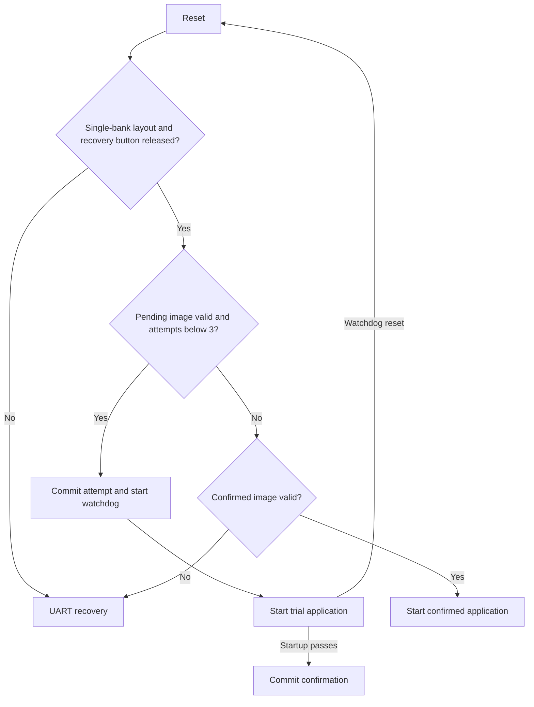

# Architecture and flash layout

The bootloader runs first after reset. It either starts an application or keeps USART3 open for recovery commands. The Python updater runs on a separate computer. The bootloader and demo applications share the format of the flash boot journal.

A failed journal write during trial setup does not authorize a jump into the trial image. The bootloader clears a failed pending trial before falling back and enters recovery if it cannot safely save that state. A button-forced recovery session leaves the trial count alone. If a trial is already pending, release the button and reboot to let it finish before starting another update.

## Flash sectors and execution addresses

| Sectors | Use | Start | End inclusive | Vector table |
| --- | --- | --- | --- | --- |
| 0–3 | Bootloader | `0x08000000` | `0x0801FFFF` | `0x08000000` |
| 4 | Primary journal | `0x08020000` | `0x0803FFFF` |  |
| 5–7 | Slot A | `0x08040000` | `0x080FFFFF` | `0x08040200` |
| 8–10 | Slot B | `0x08100000` | `0x081BFFFF` | `0x08100200` |
| 11 | Backup journal | `0x081C0000` | `0x081FFFFF` |  |

This allocation uses the 2 MiB single-bank map from RM0410. The bootloader checks the `nDBANK` bit and only accepts slot identifiers through the protocol. The update handler rejects the confirmed slot and translates A or B into three specific sectors. The flash driver also excludes bootloader sectors and addresses below `0x08020000`. The demo uses 128 KiB of DTCM for the stack and C runtime data. The validator also accepts aligned stack tops within the device’s contiguous SRAM address range.

Flash accesses can stall instruction fetch while the single bank is busy. The host waits for a reply before sending more data and gives erase and verify more time than normal commands. The CPU and flash accelerator caches are left at their reset settings by the supplied firmware. The flash driver's polling loop guards against repeated busy reads when the CPU can execute. Timing during a flash stall must be measured on the board.

## Boot journal

Each 24-byte record contains a generation, confirmed slot, pending slot, attempt count, CRC32 and a commit word. Slot value 255 means empty. The CRC covers the first four 32-bit fields. The writer programs the commit word last. At boot, the reader checks both sectors and loads the newest valid committed record.

When the current sector fills, the writer erases the other sector and commits the new record there. The previous committed record stays in the current sector until the new sector has a valid successor. A reset after a partial write leaves the previous valid generation available. If both journals have no valid record, recovery starts with both slots unset and waits for an update.

## Handoff and confirmation

The validator checks that the startup stack points into SRAM, that the reset handler is a Thumb address within the selected image, and that the payload bytes match their SHA-256 digest. The handoff disables interrupts, stops SysTick, clears pending interrupts, sets the vector table address (VTOR), loads the application’s main stack pointer and branches to the application reset handler. The application startup code initializes its own runtime memory and re-enables interrupts.

The trial counter is persisted before each jump. The bootloader starts IWDG in software for the trial. The healthy example uses its compile-time slot and confirms only when that slot matches the pending record. It commits itself as confirmed, clears the pending state and feeds IWDG. The failure build turns on B’s LED and deliberately hangs. A larger FreeRTOS demo could wait for critical tasks and peripherals to report healthy before committing, and feed the watchdog only while they remain healthy.

- [STMicroelectronics RM0410 reference manual](https://www.st.com/resource/en/reference_manual/rm0410-stm32f7-series.pdf)
- [NUCLEO-F767ZI board documentation](https://www.st.com/en/evaluation-tools/nucleo-f767zi.html)
